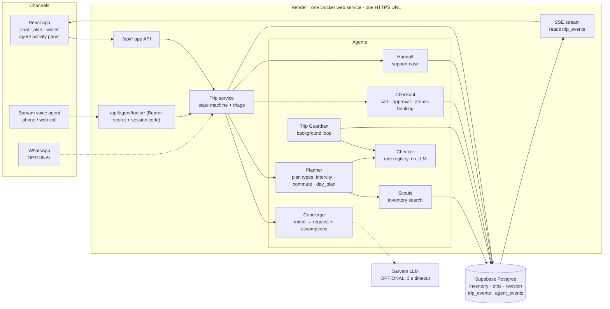
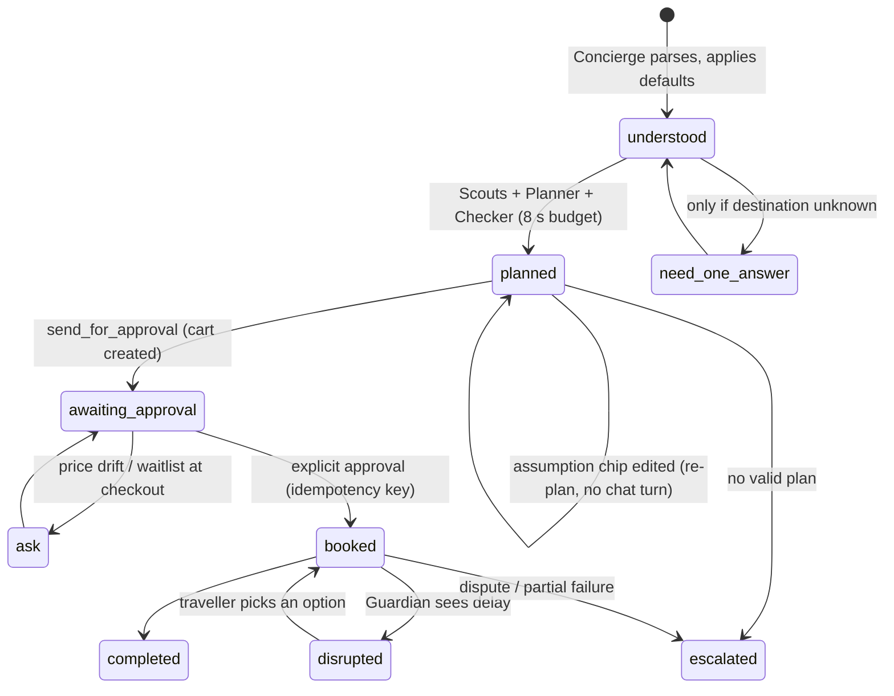
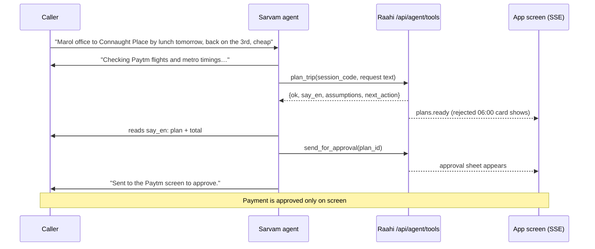

# Raahi architecture

**The model plans. Code checks. The traveller pays once. A human handles exceptions.**

Raahi is one FastAPI service with two front doors (the app and the Sarvam voice agent). Both doors call the same
trip service, so there is one implementation of every behaviour. The LLM is used at exactly two narrow points
(intent extraction and a one-line explanation), each with a timeout and a deterministic fallback. Everything that
decides money, time or safety is plain Python.

## 1. System diagram

## 2. Why this is agentic, not a chatbot

| Property | How Raahi does it |
|---|---|
| Acts across systems | One request fans out to metro, flight, train, hotel, add-ons, then books all of them in one cart |
| Plans before asking | Fills gaps with defaults and shows them as editable assumption chips. Zero questions before the first plan |
| Verifies its own work | Every candidate goes through the Checker. Rejected candidates are kept and shown with the failing rule |
| Keeps working after the user leaves | The Guardian watches booked trips, detects a delay, re-checks later legs and raises options first |
| Knows its limits | Triage sends disputes, no-valid-plan and partial payment failures to a human (Handoff) |
| Humans stay in control | Nothing is charged without an approval record. Voice can never approve payment |
| Observable | Every agent step writes an `agent_events` row (agent, action, in, out, status, duration). The panel streams it |

## 3. The request lifecycle (state machine, not a free-form LLM loop)

Every transition is one DB transaction that bumps `trips.revision` and appends a `trip_events` row. A caller
holding an old revision is rejected (stale update), so the app and the phone can never overwrite each other.

## 4. Plan types share one engine

A plan type is a small plug-in with three parts, so commute and day plans are thin variants:

| Part | intercity (built) | commute | day_plan |
|---|---|---|---|
| `generate(inventory, request)` | metro → flight → metro → walk → hotel, plus return | walk / metro / city bus, built backwards from arrive-by, gives "leave by" | travel → show → dinner → travel home, one template first |
| `rules` | 10 shared rules | `arrive_by`, `first_last_metro`, `connection_time`, `commute_buffer` | `no_overlap`, `venue_open`, `slot_available`, `show_to_dinner_buffer`, `last_metro_home`, `budget_per_person`, `dietary_match`, `travel_between_venues` |
| `defaults` | 1 traveller, cheapest, economy, one-way unless return said | arrive 09:30, cheapest | party 2, 17:00 to 22:30, mid budget, casual |

Cart, approval, wallet, Guardian, triage and the activity panel are shared and do not know the plan type.

## 5. Where the LLM is (and is not) used

| Step | Engine | Fallback |
|---|---|---|
| Intent → structured request | Sarvam LLM with a JSON schema, validated by Pydantic | Rules parser (EN, HI, Hinglish), always run for the demo sentence |
| One-line "why this plan" | Sarvam LLM | Template sentence from the checked numbers |
| Candidate generation, ranking, checks, prices, booking | **Never the LLM** | n/a |
| Voice conversation | Sarvam voice agent | The same flow in app chat |

## 6. The voice path (Sarvam)

Verified on 31 Oct 2026 through the Sarvam MCP. The workspace has HTTP "API tools". A tool sends a body, can be
given a timeout of up to 30 s and a stored bearer credential, and speaks a Jinja `resp_template` rendered from our
JSON. So the agent says exactly our `say_en`, and `on_failure` gives an honest line when the call fails. A test call
dials a **verified** phone number and needs no purchased number. Judges calling **in** needs a purchased number, an
onboarded endpoint and a deployment. The workspace currently has none (see `docs/RISKS.md`, R3).

The tool takes the raw utterance plus the slots the agent heard. The backend re-parses with the same Concierge,
so voice and chat cannot disagree.

## 7. Data and realtime

- Postgres (Supabase) is the only state. The schema is generated from `app/models.py` into `supabase/migrations/`. RLS is on and anon access is revoked.
- `trip_events` is append-only. The SSE endpoint sends a snapshot first, then events by `seq`, supports `Last-Event-ID` replay and sends a heartbeat every 15 s. Clients ignore events with an older revision.
- Inventory is small and read-mostly, so it is cached in memory for 60 s to keep planning under 5 s even with a slow DB link.

## 8. Security model

- Tool endpoints: bearer secret (configured as a stored credential in the Sarvam console, never in a prompt), plus a session code that binds a call to one conversation. The model never passes a trip or user id it chose itself.
- Demo endpoints: PIN header. Rate limit on public endpoints. Errors return class names, never connection strings.
- No tool accepts UPI PIN, OTP, card, CVV, Aadhaar, PAN or passport numbers. `send_for_approval` creates a cart and never charges.
